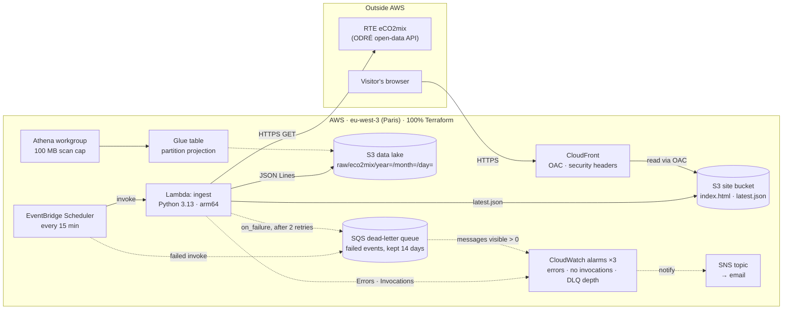

# watt-next ⚡🌱

**Carbon-aware energy data for France, built entirely with Terraform on AWS.**

🔗 **Live:** https://dqppqugr8xyim.cloudfront.net — current carbon intensity of the French grid + the last 24 hours, refreshed every 15 minutes.

## What it does

France's electricity is mostly low-carbon: nuclear alone was about 68% of production in 2025. Yet the grid's
carbon intensity still swings during the day: gas plants start up at demand peaks, while solar and wind
push it down when they produce. **watt-next** collects RTE's near-real-time eCO2mix data every 15 minutes,
stores it in a queryable data lake, and finds the **lowest-carbon hours**, so that workloads that can wait
(batch jobs, backups, EV charging) can run when the grid is cleanest.

*Coming next: a 24-hour forecast of the cleanest hours (see [Roadmap](#roadmap)).*

## Architecture



## How it works

Every 15 minutes:

1. **EventBridge Scheduler** invokes the **ingest Lambda** (Python 3.13, arm64).
2. The Lambda fetches the latest **eCO2mix** data from RTE's open-data API (ODRÉ).
3. It writes the raw records as JSON Lines into an **S3 data lake**, partitioned by `year=/month=/day=`.
4. It writes a small `latest.json` to the **site bucket**, served by **CloudFront** (private bucket, Origin Access Control).
5. **Athena** queries the data lake through a **Glue** table with partition projection, e.g. *"What were the cleanest hours this week?"*

If anything fails: Scheduler and Lambda both retry, failed events land in an **SQS dead-letter queue**, and **CloudWatch alarms** email me (errors, missing invocations, messages in the DLQ).

## Design decisions

| Decision | Why | Alternative considered |
|---|---|---|
| **Serverless ingestion** (Lambda + EventBridge Scheduler) | A 15-minute batch job runs ~3,000 times a month: almost free, nothing to patch or keep running | EC2 or a container: always-on cost for a job that runs a few seconds |
| **Lambda on arm64** (Graviton) | Same code, ~20% cheaper per millisecond | x86_64 (the default) |
| **Partition projection** on the Glue table | Partitions are computed from the date: no crawler to run or pay for, new days are queryable immediately | A Glue crawler on a schedule |
| **S3 data lake + Athena** | Storage costs cents; Athena bills per query and nothing when idle; schema-on-read over raw JSON | A database (RDS, DynamoDB): billed every hour, even when nobody queries it |
| **CloudFront + OAC** in front of a private bucket | The bucket stays private (only this distribution can read it, via `AWS:SourceArn`); HTTPS; content cached at the edge | S3 static website hosting: public bucket, HTTP only |
| **GitHub OIDC** for CI | No long-lived secret to store, rotate or leak: each run gets credentials that expire within the hour, pinned to this repo and event; every session is visible in CloudTrail | AWS access keys stored as GitHub secrets |
| **Native S3 state locking** (`use_lockfile`) | One resource and one permission set fewer; the current standard since Terraform 1.11, which deprecated DynamoDB locking | A DynamoDB lock table |
| **Own `secure_bucket` module** | One secure baseline for 4 buckets: encryption, no public access, TLS only, `prevent_destroy` | A registry module (`terraform-aws-modules/s3-bucket`): powerful, but much bigger than needed here |
| **Separate `bootstrap/` and `infra/`** | The state bucket and the CI roles can't be managed by the state and the CI they enable; a human applies them once | One configuration for everything |
| **Paris region** (eu-west-3) | French data, French users, data stays in France | us-east-1 (cheapest, where the NOAA weather data lives; planned for v0.5: *compute moves to the data*) |

## Security

- **No long-lived credentials.** Humans sign in through IAM Identity Center (SSO); CI assumes roles through GitHub OIDC. The account has no IAM users and no access keys.
- **Least privilege, one role per job.** The ingest Lambda can only write to `raw/eco2mix/*` in the data lake and to `data/latest.json` on the site. The CI *plan* role is read-only, plus the state lock file.
- **Private by default.** Every bucket comes from the `secure_bucket` module: public access blocked, encrypted, TLS-only, `prevent_destroy`. The site bucket is readable only by this CloudFront distribution (OAC + `AWS:SourceArn`), which adds security headers (HSTS, X-Frame-Options, nosniff).
- **Confused-deputy protection** on service roles (`aws:SourceAccount` on the Scheduler's trust policy).
- **Every change is reviewed.** Each pull request runs `fmt`, `validate`, `tflint`, `checkov` and a `terraform plan`. Applies run only from `main`, through a protected GitHub environment, and the AWS trust policy accepts no other path.
- **Scanner findings are decisions, not noise.** checkov: 220 checks pass; every skipped check is listed in [`.checkov.yaml`](.checkov.yaml) with its reason.
- **No secrets in code.** The alert email comes from a git-ignored file locally and from a GitHub secret in CI. The full Git history was scanned with gitleaks.

**Known gaps, on the roadmap:** the CI *apply* role uses `AdministratorAccess` (to be scoped to watt-next resources) · state encrypted with SSE-S3 rather than a customer-managed KMS key · no custom domain yet, so TLS 1.2-minimum isn't enforced · Lambda concurrency limit pending an account quota increase.

## Cost

**About $0.05 per month** (measured on the AWS bill, November 2026). A $5 budget alarm (80% actual, 100% forecast) guards against surprises.

| Service | Usage | Monthly cost |
|---|---|---|
| S3 | ~6,000 writes, a few MB stored | ~$0.05 |
| Athena | a few queries over partitioned data, 100 MB cap per query | < $0.01 |
| Lambda, EventBridge Scheduler, SQS, SNS, CloudWatch (3 alarms), CloudFront, Glue | within AWS's always-free allowances | $0 |

**Cost-driven choices:** serverless instead of always-on compute · Athena pay-per-query instead of a database · partition projection instead of a crawler · no NAT gateway (~$35/month), so the Lambda runs outside a VPC · arm64 Lambda (~20% cheaper) · lifecycle rules expire temporary and old data.

## Repository layout

```
bootstrap/                 # applied once by a human: state bucket + GitHub OIDC roles (local state)
infra/                     # the platform: data lake, ingestion, analytics, site, monitoring (remote state)
modules/secure_bucket/     # reusable private bucket: encryption, public access block, TLS-only, prevent_destroy
lambda/ingest/             # ingestion code (Python)
site/                      # the public page
.github/workflows/         # CI: fmt, validate, tflint, checkov, plan on PR, gated apply
.tflint.hcl  .checkov.yaml # linter config + security-scan decisions (each skip has its reason)
```

## Deploy it yourself

**Prerequisites:** an AWS account with an SSO profile, Terraform ~> 1.16, the AWS CLI v2, and a GitHub fork of this repo.

```bash
# 1. Bootstrap (once, by a human): state bucket + GitHub OIDC roles, local state
#    First edit bootstrap/ci.tf → local.github_repo_sub = "<Owner>@<owner_id>/<repo>@<repo_id>"
#    (IDs: gh api repos/<owner>/<repo> --jq '"\(.owner.id) \(.id)"')
cd bootstrap
terraform init && terraform plan -out=bootstrap.tfplan && terraform apply bootstrap.tfplan
terraform output   # state bucket name + the two CI role ARNs

# 2. The platform
cd ../infra
#    Edit backend.tf → bucket = "<the state bucket name from step 1>" (backends can't use variables)
echo 'alert_email = "you@example.com"' > local.auto.tfvars   # git-ignored
terraform init
terraform plan -var-file=dev.tfvars -input=false -out=infra.tfplan
terraform apply infra.tfplan
#    Then confirm the SNS subscription email AWS sends you.
```

**3. CI:** add the GitHub variables `AWS_PLAN_ROLE_ARN` and `AWS_APPLY_ROLE_ARN`, the secret `ALERT_EMAIL`, and a `production` environment with a required reviewer.

> ⚠️ The data lake and state buckets have `prevent_destroy`. Tearing down is a deliberate, two-step act.

## Roadmap

- **v0.3 (now):** live ingestion every 15 min · partitioned data lake + Athena · public page · remote state · CI with OIDC, tflint, checkov, plan on PR, gated apply
- **Hardening:** scope the CI apply role to watt-next resources · KMS customer-managed key for the state · custom domain + ACM certificate (TLS 1.2 minimum) · Lambda concurrency limit · pre-commit hooks · `terraform test` · automated tool updates (Renovate)
- **v0.5: weather forecasts.** Ingest NOAA GFS from AWS Open Data in us-east-1 (SNS → SQS → Lambda), extract only France, ship the subset to Paris. *Compute moves to the data.*
- **v0.6: prices.** Add ENTSO-E day-ahead prices: the **cleanest and the cheapest** hours.
- **v0.7: forecast.** Correlate wind and solar forecasts with actual production, and publish a **24-hour carbon forecast** on the page.
- **v0.8: grid brief.** A nightly plain-language summary on the page, orchestrated by Step Functions: Athena computes every figure, Amazon Bedrock only writes the sentences (no model-generated numbers).
- **v0.9: carbon-aware CI.** A "best window" API and a GitHub Action that delays non-urgent workflows to the cleanest hour.
- **v1.0: multi-account platform.** Migrate into a landing zone (AWS Organizations, IAM Identity Center, SCPs, central CloudTrail and GuardDuty, separate dev and prod accounts) using `moved` and `import` blocks, then schedule the platform's own jobs in the cleanest hours.

## Data source & licence

Grid data: **éCO2mix national real-time data**, © [RTE](https://www.rte-france.com), distributed by [Open Data Réseaux Énergies (ODRÉ)](https://odre.opendatasoft.com), under the [Licence Ouverte / Open Licence v2.0](https://www.etalab.gouv.fr/licence-ouverte-open-licence/). watt-next is an independent project, not affiliated with RTE.
