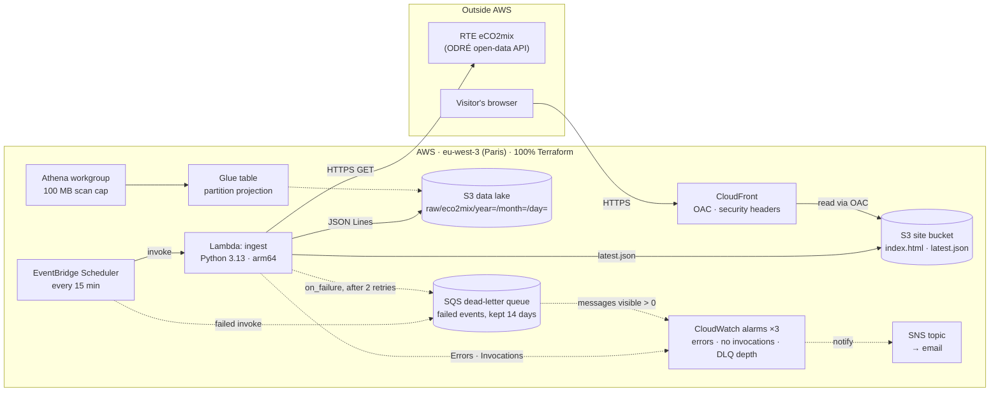

# watt-next ⚡🌱

**Carbon-aware energy data for France, built entirely with Terraform on AWS.**

🔗 **Live:** https://dqppqugr8xyim.cloudfront.net — current carbon intensity of the French grid + the last 24 hours, refreshed every 15 minutes.

## What it does

France's electricity is mostly low-carbon: nuclear alone was about 68% of production in 2025. Yet the grid's
carbon intensity still swings during the day: gas plants start up at demand peaks, while solar and wind
push it down when they produce. **watt-next** collects RTE's near-real-time eCO2mix data every 15 minutes,
stores it in a queryable data lake, and finds the **lowest-carbon hours**, so that workloads that can wait
(batch jobs, backups, EV charging) can run when the grid is cleanest.

*Coming next: a 24-hour forecast of the cleanest hours (see [Roadmap](#roadmap)).*

## Architecture



## How it works

Every 15 minutes:

1. **EventBridge Scheduler** invokes the **ingest Lambda** (Python 3.13, arm64).
2. The Lambda fetches the latest **eCO2mix** data from RTE's open-data API (ODRÉ).
3. It writes the raw records as JSON Lines into an **S3 data lake**, partitioned by `year=/month=/day=`.
4. It writes a small `latest.json` to the **site bucket**, served by **CloudFront** (private bucket, Origin Access Control).
5. **Athena** queries the data lake through a **Glue** table with partition projection, e.g. *"What were the cleanest hours this week?"*

If anything fails: Scheduler and Lambda both retry, failed events land in an **SQS dead-letter queue**, and **CloudWatch alarms** email me (errors, missing invocations, messages in the DLQ).

## Design decisions

<!-- Part C -->

## Security

<!-- Part C -->

## Cost

<!-- Part C -->

## Repository layout

```
bootstrap/                 # applied once by a human: state bucket + GitHub OIDC roles (local state)
infra/                     # the platform: data lake, ingestion, analytics, site, monitoring (remote state)
modules/secure_bucket/     # reusable private bucket: encryption, public access block, TLS-only, prevent_destroy
lambda/ingest/             # ingestion code (Python)
site/                      # the public page
.github/workflows/         # CI: fmt, validate, tflint, checkov, plan on PR, gated apply
.tflint.hcl  .checkov.yaml # linter config + security-scan decisions (each skip has its reason)
```

## Deploy it yourself

<!-- Part D -->

## Roadmap

<!-- Part D -->

## Data source & licence

<!-- Part D -->
